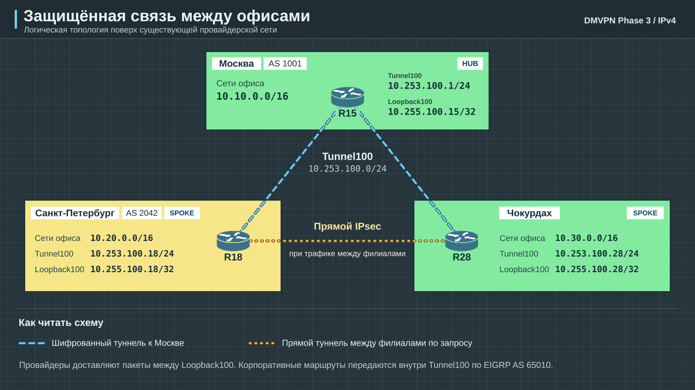

# Организация защищённой связи между удалёнными офисами компании с использованием DMVPN/IPsec

Москва, Санкт-Петербург и Чокурдах объединены корпоративным IPv4 VPN поверх сети провайдеров. Москва принимает регистрации обоих филиалов. Когда Петербургу нужно передать пакеты в Чокурдах, филиалы могут установить прямое защищённое соединение. Это проверено на маршрутизаторе R18: все 10 контрольных ping получили ответ, а счётчики IPsec для R28 увеличились на 10 в каждом направлении.

[Конфигурации 31 устройства](configs/) · [Полный вывод контрольного теста](evidence/04-direct-ipsec.txt)

## Архитектура

**Физическая топология стенда EVE-NG**

**Логическая схема DMVPN**

| Офис | Роль | Внешний адрес (Loopback100) | Адрес в VPN (Tunnel100) | Офисные сети |
|---|---|---|---|---|
| Москва | [R15](configs/R15.cfg), центр | `10.255.100.15` | `10.253.100.1/24` | `10.10.0.0/16` |
| Санкт-Петербург | [R18](configs/R18.cfg), филиал | `10.255.100.18` | `10.253.100.18/24` | `10.20.0.0/16` |
| Чокурдах | [R28](configs/R28.cfg), филиал | `10.255.100.28` | `10.253.100.28/24` | `10.30.0.0/16` |

· [Все 46 соединений](docs/links.csv) · [IPv4-адреса интерфейсов IOS](docs/ipv4-interfaces.csv). 
#### Лабытнанги присутствует на исходном стенде; в корпоративном VPN участвуют только три офиса из таблицы.

## Как устроена сеть

1. **Транспорт.** BGP между офисами и провайдерами обеспечивает достижимость внешних адресов VPN. У Москвы два выхода — через Киторн и Ламас, с предпочтением Ламаса. Петербург подключён к Триаде двумя линками. Внутри Триады используются IS-IS и iBGP с отражателем маршрутов R23.
2. **VPN.** Сначала Москва и Петербург соединены статическим GRE/IPsec на `Tunnel90`. После проверки этот интерфейс заменён на `Tunnel100`, подключён Чокурдах. В финальной схеме DMVPN Phase 3 центр R15 принимает регистрации NHRP и отправляет redirect, филиалы поддерживают shortcut. GRE защищён ESP в транспортном режиме (AES-256, HMAC-SHA-256), ключи согласуются через IKEv2.
3. **Маршруты офисов.** Внутри VPN работает EIGRP AS 65010. На R15 разрешённые офисные префиксы передаются между EIGRP и московским OSPF; на R18 — между VPN и внутренним EIGRP AS 2042. R28 объявляет в VPN суммарный префикс Чокурдаха.
4. **Выбор линии и PAT.** На R28 корпоративные назначения исключены из PBR: пакет идёт по таблице маршрутизации через VPN. Для внешних адресов VLAN 10 предпочитает R25, VLAN 20 — R26, состояние линий отслеживается с помощью IP SLA. PAT на границах офисов применяется к внешнему трафику; корпоративные сети исключены из трансляции. Исходящие ACL на WAN блокируют отправку открытых пакетов к удалённым офисным сетям.
5. **Сервисы.** Шесть DHCP-пулов обслуживают клиентские VLAN 10 и 20, VLAN 99 используется для управления. Источник времени — R15 (`10.10.255.15`); его адрес указан на 17 клиентах NTP. На 18 офисных устройствах настроен SSHv2 с ограничением источников.

## Результаты проверок

| Что проверялось | Наблюдение |
|---|---|
| Доступность внешних концов VPN | [Шесть направлений](evidence/01-underlay.txt), в каждом 5 ответов из 5. |
| Промежуточный статический GRE/IPsec | [R15](evidence/static-gre/R15-static-gre.txt) и [R18](evidence/static-gre/R18-static-gre.txt): `Tunnel90`, IKEv2 в состоянии `READY`, в обе стороны 5/5. |
| Регистрация филиалов | На [R15](evidence/02-dmvpn.txt) оба филиала имеют статус `UP` с признаком `D` (динамическая запись). |
| Прямой путь между филиалами | На [R18](evidence/03-spoke-to-spoke.txt) видно два разных пира: динамический R28 и отдельно центр R15. |
| Шифрование прямого трафика | [R18, до и после 10 ping](evidence/04-direct-ipsec.txt): от `10.20.0.1` до `10.30.10.1` — **10/10**. Для пира R28 (`10.255.100.28`): зашифровано **27 → 37**, расшифровано **24 → 34**. Ошибки отправки и приёма — **0 / 0**. |
| DHCP | Все 6 клиентов получили адреса и шлюзы по DHCP. [Таблица адресов](evidence/client-addresses.md). |
| Связность клиентов | 26 серий межофисных ping и 6 серий до внешнего тестового адреса `198.18.0.1`: 160/160 ответов. |
| Маршрутизация | OSPF — FULL, EIGRP — соседства установлены, IS-IS — UP. BGP-сессии подтверждены, включая связи Киторна с R14 и R21 после запуска R22. |
| PAT | Все три офиса достигли внешнего тестового адреса. Активные трансляции зафиксированы на R15, R18 и R28. |
| PBR и IP SLA | На R28 VLAN 10 использует `10.254.0.50`, VLAN 20 — `10.254.0.54` при трансляции внешнего трафика. Оба track в состоянии UP; 716 успешных операций IP SLA и 0 ошибок для каждой линии. |
| NTP | R15 — источник времени, 17 клиентских устройств синхронизированы. |
| SSH | На 18 офисных устройствах включён SSHv2. Вход по SSH с R15 (10.10.255.15) на SW29 (10.30.99.29) подтверждён: команда `show users` на SW29 показала пользователя `labadmin` на линии `vty 0`. |

Полные результаты: [единый журнал проверок стенда, включая повторную проверку BGP и SSH](evidence/checks.txt), [подробное описание результатов](docs/audit-dmvpn.md).

## Выводы

Корпоративная сеть объединяет три офиса. DMVPN Phase 3 обеспечивает прямой защищённый обмен между филиалами; работоспособность подтверждена трафиком между компьютерами и счётчиками ESP. DHCP, PAT, PBR и NTP проверены на работающем стенде. В проекте один центр DMVPN, корпоративный VPN обслуживает IPv4.
