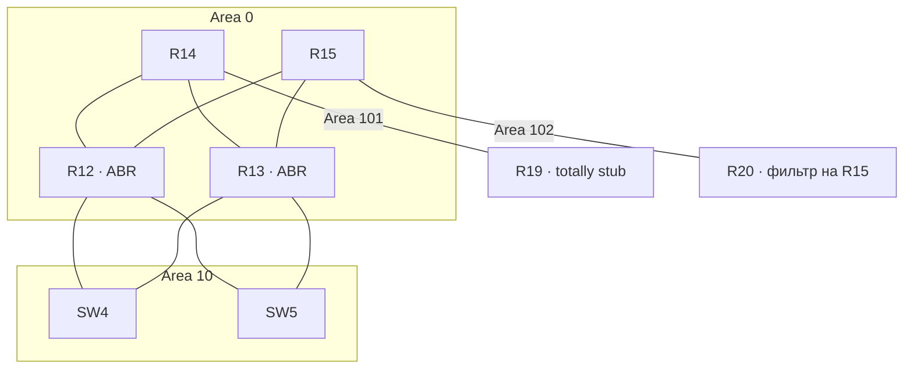

# Лабораторная работа № 3. OSPF

## Цель и план

Настроить OSPF в Москве, разделить сеть на зоны и ограничить распространение
маршрутов. Для IPv4 используется OSPFv2, для IPv6 — OSPFv3.

1. Назначить IPv6-адреса и включить OSPF на восьми L3-устройствах Москвы.
2. Объединить верхние линки в area 0, нижние — в area 10.
3. Объявить маршрут по умолчанию и настроить totally stub area 101.
4. На R15 исключить сети area 101 из анонсов в area 102.

## Зоны

| Зона | Участок | Тип |
| --- | --- | --- |
| 0 | Линки R14/R15 к R12/R13, Loopback0 R14 и R15 | Backbone |
| 10 | Линки R12/R13 к SW4/SW5, их Loopback0 и VLAN 10/20/99 | Normal |
| 101 | Линк R14–R19 и Loopback0 R19 | Totally stub |
| 102 | Линк R15–R20 и Loopback0 R20 | Normal с фильтрацией на входе |

R12 и R13 — пограничные маршрутизаторы ABR между area 0 и area 10.
Зона назначается интерфейсу: верхние интерфейсы этих маршрутизаторов входят
в area 0, нижние и Loopback0 — в area 10. Магистраль связна через существующие линки.



[Полная схема стенда](images/topology.png) · [Адреса и зоны интерфейсов](addressing.md).

## Маршрут по умолчанию

R14 объявляет IPv4 и IPv6 маршруты по умолчанию:

```
router ospf 1
 default-information originate always metric 10 metric-type 2
!
router ospfv3 1
 address-family ipv6 unicast
  default-information originate always metric 10 metric-type 2
 exit-address-family
```

R12/R13 получают default вместе с остальными маршрутами.

## Area 101

На R14 в обоих процессах настроено `area 101 stub no-summary`,
на R19 - `area 101 stub`.

## Фильтрация в area 102

На R15 заданы списки префиксов:

```
ip prefix-list OSPF-NO101-V4 seq 5 deny 10.10.0.8/30 le 32
ip prefix-list OSPF-NO101-V4 seq 10 deny 10.255.0.19/32
ip prefix-list OSPF-NO101-V4 seq 100 permit 0.0.0.0/0 le 32
!
ipv6 prefix-list OSPF-NO101-V6 seq 5 deny fd10:10:10:3::/64 le 128
ipv6 prefix-list OSPF-NO101-V6 seq 10 deny fd10:10:10:ffff::19/128
ipv6 prefix-list OSPF-NO101-V6 seq 100 permit ::/0 le 128
!
router ospf 1
 area 102 filter-list prefix OSPF-NO101-V4 in
!
router ospfv3 1
 address-family ipv6 unicast
  area 102 filter-list prefix OSPF-NO101-V6 in
 exit-address-family
```

В area 102 не передаются маршруты к линии R14–R19 и Loopback0 R19.
Остальные сети OSPF Москвы и default разрешены.

## Файлы

- [Конфигурации устройств](configs/README.md).
- [Команды внесённых изменений](changes/README.md).
- [IPv4/IPv6-адресация и зоны](addressing.md).
