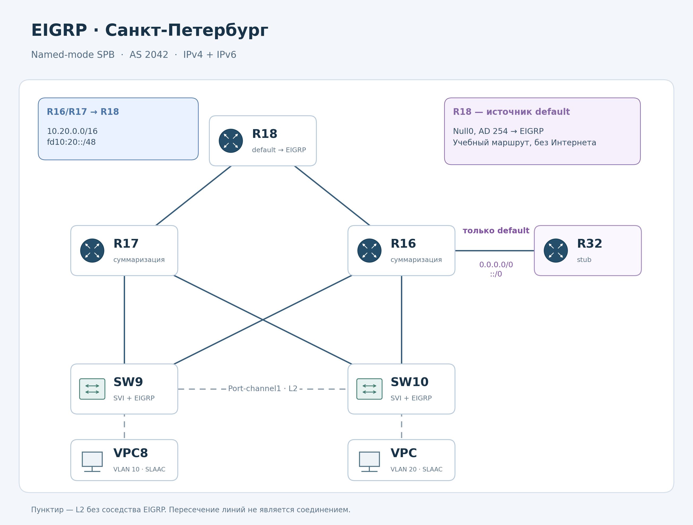

# Лабораторная работа № 5. EIGRP

## Цель и план

Настроить EIGRP named-mode для IPv4 и IPv6 в офисе Санкт-Петербург.

1. Объединить R18, R16, R17, R32, SW9 и SW10 в процесс `SPB`, AS `2042`.
2. Настроить суммаризацию на R16/R17 и передачу только default к R32.
3. Добавить IPv6 и сохранить конфигурации.

## Основные настройки

| Устройства | Настройка |
| --- | --- |
| Все шесть L3-устройств | `router eigrp SPB`, address-family IPv4 и IPv6, AS 2042 |
| R16 и R17 → R18 | Только `10.20.0.0/16` и `fd10:20::/48`; более точные префиксы подавлены |
| R18 | Источник IPv4/IPv6 default через выборочную redistribution static |
| R16 → R32 | Выходной prefix-list пропускает только `0.0.0.0/0` и `::/0` |
| R32 | `eigrp stub connected summary`; собственные сети объявляются в сторону R16 |
| Loopback и SVI | Пассивные интерфейсы EIGRP |

Суммаризация применяется на `Ethernet0/1` R16 и R17 в сторону R18.
Между R16/R17 и SW9/SW10 передаются подробные маршруты для внутренней связности.
На R32 из EIGRP поступает только default для каждой версии IP;
собственные connected/local-маршруты остаются.

IPv4 Loopback устройств Петербурга перенесены из общего блока `10.255.0.0/24`
в `10.20.255.0/24`
VPC получают IPv6 через SLAAC от своих коммутаторов.

На R18 созданы учебные default-маршруты в `Null0` с AD 254.
В EIGRP перераспределяются только они.
Внешние интерфейсы R18 в сторону Триады исключены из EIGRP.

## Файлы

- [Конфигурации](configs/README.md).
- [Адресация и изменение Loopback](addressing.md).
- [Команды настройки](changes/README.md).
- [Полная схема стенда](images/topology.png).
