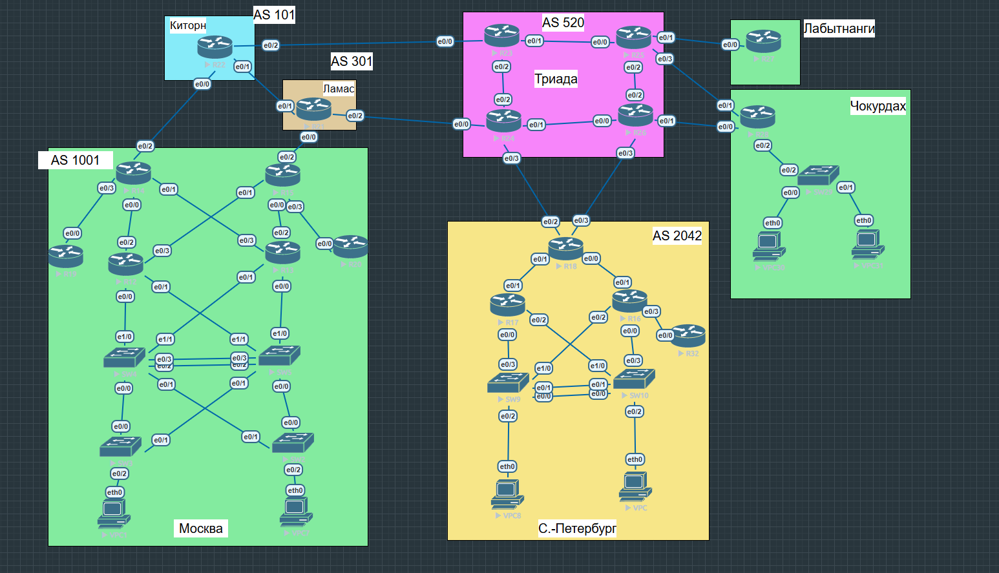

# Лабораторная работа №10. Основные протоколы сети Интернет

**Цель:** обеспечить выдачу адресов и синхронизацию времени в Москве, настроить NAT и PAT в трёх офисах и проверить сквозную связь.

## Топология

## Настройка

1. **Динамический PAT.** Для внешнего трафика клиентских VLAN в Москве R14 и R15 используют по одному адресу трансляции: 10.10.250.14 и 10.10.250.15 соответственно. В Санкт-Петербурге R18 использует пул из пяти адресов с параметром `overload`: один адрес пула могут одновременно использовать несколько клиентов.
2. **Статический NAT и проброс портов.** Для R20 задано постоянное соответствие двух IPv4-адресов (1:1). Для SSH на R19 и SW29 настроен статический PAT: к внутреннему устройству направляются подключения на указанный TCP-порт внешнего адреса.
3. **DHCP.** R12 выдаёт адреса клиентам VLAN 10, R13 — клиентам VLAN 20. SW4 и SW5 работают как DHCP-ретрансляторы для соответствующих VLAN.
4. **NTP.** На устройствах Москвы настроены два сервера времени: R12 и R13. В DHCP-пулах их адреса также указаны в опции 42.

## Результаты

| Проверка | Результат |
|---|---|
| PAT Москвы | VPC1 получил 3/3 ответа от 10.254.0.2 через R14, VPC7 — 3/3 от 10.254.0.6 через R15. В таблицах NAT видны адреса клиентов после трансляции: 10.10.250.14 и 10.10.250.15. |
| PAT Петербурга | VPC8 получил 3/3 ответа от 10.255.0.23. R18 транслировал 10.20.10.10 в 10.20.250.1 из пула 10.20.250.1–10.20.250.5. |
| Статический NAT R20 | VPC30 получил 3/3 ответа от 10.10.250.20. На R15 видна ICMP-трансляция к 10.255.0.20. |
| Удалённое управление R19 | С R18 через 10.10.250.19 и с R12 через 10.255.0.19 выполнен вход по SSH под netops. На R19 команда `show users` показала обе проверенные сессии в соответствующих выводах. |
| Статический PAT Чокурдаха | С R27 выполнен SSH-вход через 10.254.0.50:2222. На SW29 получено приглашение и выполнена команда show users. |
| DHCP Москвы | VPC1 получил 10.10.10.100/24 со шлюзом 10.10.10.2, VPC7 — 10.10.20.100/24 со шлюзом 10.10.20.3. Адреса и MAC совпали с привязками R12 и R13. |
| NTP Москвы | R12 и R13 использовали собственные часы. Восемь маршрутизаторов и коммутаторов выбрали R12. Синхронизация часов двух VPCS не подтверждена. |
| Связность офисов | Между четырьмя площадками проверено 12 направлений. На 36 ICMP эхо-запросов получено 36 ответов. |

[Конфигурации](configs/) · [Адресация и матрица проверок](docs/details.md) · [Журнал проверок](evidence/checks.txt)
